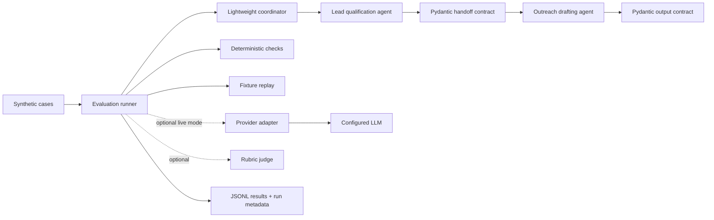

# PLAN.md — agent-eval-harness

## Goal

Deliver the smallest credible, testable agent-evaluation harness within approximately 10–12 evening hours. Prioritize correctness and evidence over framework count.

## Architecture

## Design principles

1. Deterministic CI is the trusted required gate.
2. Live LLM evaluation is opt-in and treated as variable.
3. Every score must be traceable to actual recorded evidence.
4. Guardrail failures cannot be hidden by an aggregate score.
5. No baseline is invented, silently refreshed, or committed without review.
6. Avoid LangGraph and Langfuse until a specific requirement justifies them.
7. Phased execution: items 1 through 6 accepted and verified; item 7 (optional tracing) formally deferred; item 8 (README and final closeout) implementation complete and verified, pending formal reviewer acceptance. Later items require explicit owner authorization.

## Components

- `src/agent_eval_harness/contracts/`: versioned Pydantic v2 schemas (`LeadInput`, `LeadQualificationResult`, `OutreachHandoff`, `OutreachDraftResult`) adhering to D-015 (structural vs business validation separation, strictness without superficial freezing, derived properties) and D-016 (canonical qualification status).
- `src/agent_eval_harness/agents/`: `LeadQualificationAgent` and `OutreachDrafterAgent` handling prompt execution and strict contract validation.
- `src/agent_eval_harness/coordinator.py`: `WorkflowCoordinator` sequencing the agents, enforcing state invariants, routing non-qualified leads, preserving intermediate outputs on downstream failure, and emitting typed `CoordinatorResult` (D-017).
- `src/agent_eval_harness/providers/`: provider adapter boundary (`LLMAdapter`, `FakeLLMAdapter`, `ReplayingLLMAdapter`) decoupled from concrete provider SDKs (D-018, D-020).
- `src/agent_eval_harness/fixtures/`: versioned fixture models (`ReplayFixture`, `RecordedExchange`, `ExchangeStage`) and validation logic (D-020).
- `src/agent_eval_harness/evaluation/`: dataset loading, deterministic checks, scoring, and result records.
- `tests/`: contract, guardrail, coordinator, adapter, and replay tests.
- `datasets/`: synthetic, labelled, versioned cases.
- `fixtures/`: safe recorded responses for offline replay.
- `artifacts/` or a documented output directory: generated results; only commit approved baseline artifacts.
- `.github/workflows/`: required deterministic CI and optional manual live evaluation.
- `SPEC.md`, `PLAN.md`, `CHECKLIST.md`, `README.md`, `DECISIONS.md`.

The exact package layout may be adjusted by the coding agent if it preserves these boundaries and updates the docs before implementation.

## Data flow

1. Load a synthetic case with stable ID and expected properties.
2. Validate the case input.
3. Call the lead agent through the coordinator.
4. Validate the lead result against the handoff schema.
5. Pass only validated structured data to the outreach agent.
6. Validate the outreach result.
7. Run deterministic assertions.
8. In optional live mode, call the judge for rubric-defined semantic dimensions.
9. Write per-case outcomes and run metadata without secrets.
10. Compare only against a reviewed baseline when one exists.

## Evaluation policy

- Target 20 synthetic cases as a smoke/regression set, not a quality benchmark or representative sample. If time prevents reaching 20, report the actual count and reason without padding or invented claims.
- Report numerator and denominator as well as percentage.
- A single failure in a 20-case binary set changes an unweighted aggregate by 5 percentage points.
- Deterministic critical checks are independent blocking gates. Coordinator failures (`CoordinatorStatus.FAILED`) unconditionally fail the overall case.
- In semantic evaluation mode, `LLMJudge` applies a discrete 1–4 scale with dimension-level veto (all >= 3 required to pass). `JudgeVerdict.passed` is `None` when judging is not applicable (`SKIPPED_NON_APPLICABLE`), ensuring unperformed evaluations are never reported as qualitative passes, while correctly skipped workflows can pass overall if deterministic expectations pass. Judge scores are diagnostic and potentially noisy.
- Store rubric version, model identifier, configuration, rationale, timestamp, commit SHA, dataset version/hash, and per-case results.
- Fixed temperature and a model identifier improve traceability but do not promise identical outputs.
- Do not publish unmeasured metrics or invented thresholds.
- Establish the baseline only after a real run and explicit review.

## CI design

### Required PR workflow

- Runs on `ubuntu-latest`.
- No API key, live model calls, Docker service, or Langfuse dependency.
- Runs contract tests, deterministic guardrail tests, fixture replay, and selected static checks.
- Fails clearly on a test or quality-gate failure.

### Manual live workflow

- Uses `workflow_dispatch` initially.
- Select the first concrete provider after the adapter and offline harness are stable; base the choice on actual access, model availability, quota, SDK compatibility, and reproducibility metadata.
- Requires provider credentials stored as repository/environment secrets.
- Does not run with secrets on untrusted fork PRs.
- Emits a run artifact with reproducibility metadata.
- Compares to an explicitly committed baseline only when baseline metadata is compatible.
- Prefer to complete one real live evaluation and establish a reviewed measured baseline within the 10–12 hour budget, if access, quota, implementation stability, and remaining time allow.
- If infeasible, record the concrete blocker and leave the baseline unestablished; do not invent results or claim regression gating is operational.
- Never rewrites the baseline automatically.
- Per D-022, provider feasibility assessment was conducted (2026-10-28) covering Gemini, OpenAI, and Anthropic. Because no live provider adapter exists in the codebase, no provider SDKs are installed, and CI credentials/quotas are not configured, live workflow creation and baseline establishment are formally deferred to avoid hollow workflows, broken CI, or fabricated metrics. Deterministic CI and offline replay remain authoritative.

### Regression demo

- Use a separate branch or controlled mutation.
- Demonstrate a clearly attributable failure.
- Keep the main branch's passing state and approved baseline intact.

## Ordered execution strategy

The canonical task order is in `CHECKLIST.md`. Work one item at a time. Before each item, the owner approves or supplies the agent prompt; after each item, review evidence against acceptance criteria. Do not let the coding agent silently proceed to later items.

## Scope control / deferrals

Defer until the core workflow and deterministic CI are accepted:
- LangGraph
- Langfuse and Docker Compose
- Judge self-consistency runs
- PR-label-triggered live evaluation
- Complex dashboard or web UI
- Broad benchmark claims
- Automatic baseline management
- Provider selection before the adapter and deterministic harness are stable

## Completion evidence

For each completed checklist item, preserve:
- Files changed
- Commands actually run and their exit status
- Test counts and coverage only when measured
- Relevant commit SHA
- Known limitations or skipped checks
- Explicit acceptance decision

Do not claim a check passed if it was not run.
