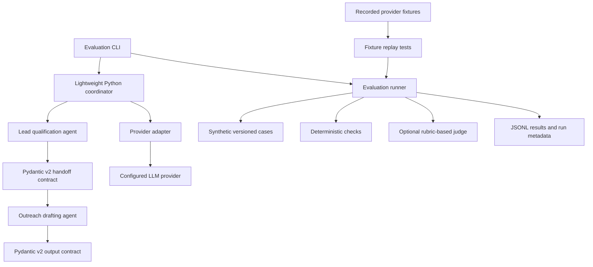

# SPEC.md — agent-eval-harness

## 1. Purpose

`agent-eval-harness` is a Git-native evaluation and regression-testing harness for a small, two-stage agent workflow:

1. A lead-qualification agent produces a structured qualification result.
2. An outreach-drafter agent consumes that result and produces a constrained draft.

The project demonstrates disciplined evaluation engineering: versioned prompts and contracts, reproducible deterministic tests, recorded fixtures, explicit guardrails, and evidence-based reporting.

## 2. Non-goals for the initial release

- Production CRM integration or sending outreach.
- Real personal data, real companies, or real prospect records.
- Claims of general model reliability based on a small synthetic dataset.
- Mandatory live-LLM calls in pull-request CI.
- Langfuse deployment, dashboards, or LangGraph unless a documented requirement justifies them.
- Automatic baseline regeneration or automatic acceptance of regressions.

## 3. Constraints

- Development environment: Windows + PowerShell.
- Repository location supplied by project owner: `E:\\Projects\\VSCode\\PostOmniroute\\career\\projects\\agent-eval-harness\\`.
- CI: GitHub Actions on `ubuntu-latest`.
- Python 3.11; Pydantic v2; pytest.
- Provider access must be behind an adapter. Provider SDK details are decoupled via `LLMAdapter` and `FakeLLMAdapter` (D-018); live provider selection happens when offline harness is complete.
- Deterministic CI must not require an API key or make live provider calls.
- No secrets in source control, fixtures, documentation, logs, or CI artifacts.
- No invented metrics. Publish only measured results with run date, commit SHA, dataset/version, model identifier where applicable, and evaluation configuration.
- Checklist items 1 through 6 are accepted and verified. Item 7 (optional tracing) is formally deferred. Item 8 (README and final closeout) implementation is complete and verified, pending formal reviewer acceptance. Later items require explicit authorization.

## 4. Proposed architecture

### Components

- **Contracts:** Pydantic v2 models for agent inputs (`LeadInput`), outputs (`LeadQualificationResult`, `OutreachDraftResult`), and inter-agent handoffs (`OutreachHandoff`). Enforce strict validation (`extra="forbid"`, `strict=True`), literal-typed SemVer versioning (`1.0.0`), and derived properties (`word_count`, `is_qualified`).
- **Agents:** `LeadQualificationAgent` and `OutreachDrafterAgent` inject `LLMAdapter`, formulate clear structured output prompts, and validate LLM completions directly into contract models.
- **Provider adapter:** `LLMAdapter` abstract base class isolates provider SDK details. `FakeLLMAdapter` provides deterministic, FIFO response queues and error injection for offline testing (D-018).
- **Coordinator:** `WorkflowCoordinator` sequences the two agents. Emits typed `CoordinatorResult` with explicit `CoordinatorStatus` enum (`COMPLETED`, `SKIPPED_DISQUALIFIED`, `SKIPPED_NEEDS_REVIEW`, `FAILED`), enforces structural state invariants, halts cleanly on non-qualified leads without calling Stage 2, preserves Stage 1 artifacts on downstream failures, and allows unexpected programming bugs to propagate uncaught (D-017).
- **Dataset:** versioned synthetic cases with stable case IDs, explicit labels, expected properties, and no real-person/company data.
- **Deterministic checks:** schema validity, required/forbidden fields, field constraints, length limits, allowed values, and explicit fixture-based guardrail cases.
- **Judge:** optional rubric-based LLM judge for semantic dimensions that deterministic checks cannot adequately assess. Record rubric version, model identifier, score, rationale, and run metadata. Do not treat its score as ground truth.
- **Fixtures:** sanitized, synthetic or otherwise safe recorded provider responses used for offline replay. No credentials or sensitive data.
- **Artifacts:** machine-readable run metadata and per-case outcomes. Avoid logging secrets or unnecessary prompt contents.
- **CI:** deterministic required workflow; live workflow is opt-in and must use protected secrets.

## 5. Contracts and validation

Acceptance requirements:

- Pydantic v2 is used; do not mix in v1 APIs.
- Inbound prospect context (`LeadInput`), stage outputs, and inter-agent messages are explicitly modeled (`LeadQualificationResult`, `OutreachHandoff`, `OutreachDraftResult`).
- Contract models carry an explicit SemVer schema version (`CURRENT_SCHEMA_VERSION = "1.0.0"`) typed via `Literal` and exported as a JSON Schema constraint (`const`/`enum`), reliably rejecting unsupported versions at runtime.
- Models enforce strict structural validation (`extra="forbid"`, `strict=True`) without superficial top-level freezing (`frozen=True` is omitted because top-level freezing does not provide deep immutability or thread-safety for nested collection fields like `list[str]`).
- Structural contract validation is kept strictly separate from business-policy rules (D-015).
- Single canonical `qualification_status` enum avoids contradictory states (D-016), with helper properties (e.g., `is_qualified`) instead of duplicate payload flags.
- Redundant payload fields are omitted; metrics like `word_count` are derived as properties rather than required from LLM output.
- Validation rejects malformed types (`strict=True`) and unexpected fields (`extra="forbid"`).
- Global whitespace stripping is disabled; specific fields enforce non-empty and non-whitespace constraints where justified.
- JSON Schema export is covered by tests and inspects actual generated schema structures.
- Tests cover valid examples, missing required fields, wrong types, unknown fields where prohibited, and unsupported schema versions.
- Errors are actionable, categorized, and sanitized to prevent leaking credentials or sensitive prompts.
- Contract validation occurs at each agent boundary, not only at the final output.

## 6. Evaluation methodology

### Dataset

Start with 20 synthetic cases only if the initial time budget permits. Treat this as a smoke/regression set, not a representative benchmark. Each case should have a stable ID, scenario label, expected behavior, and relevant deterministic assertions. Add cases based on identified failure modes rather than claiming statistical sufficiency.

With 20 equally weighted binary cases, one case changes the aggregate pass rate by 5 percentage points. Report counts alongside percentages and state the dataset size and limitations.

### Deterministic evaluation

Deterministic checks are the primary CI safety gate. They test properties that can be specified precisely without requiring external provider APIs or LLM judges:

- `check_lifecycle_status`: Verifies coordinator status matches expected (`COMPLETED`, `SKIPPED_DISQUALIFIED`, `SKIPPED_NEEDS_REVIEW`, `FAILED`).
- `check_qualification_status`: Verifies lead qualification classification matches expectation (`QUALIFIED`, `DISQUALIFIED`, `NEEDS_REVIEW`).
- `check_score_bounds`: Verifies `fit_score` falls within expected numeric ranges for the scenario (e.g., [70, 85] for mid-market, [40, 65] for MSP review, [0, 25] for non-target). Fit score bounds represent scenario plausibility ranges evaluated independently from qualification status, avoiding arbitrary qualification score cutoff assumptions.
- `check_channel_rules`: Enforces medium-specific structural invariants (EMAIL requires non-empty `subject_line`; LINKEDIN requires `subject_line is None`).
- `check_word_count_ceiling`: Enforces word count limits on message body text.
- `check_forbidden_leakage`: Critical blocking guardrail verifying that forbidden terms, competitor references, unauthorized pricing promises, and planted synthetic secret tokens (`SYNTH_SECRET_TOKEN_9912`, `SYNTH_KEY_ALPHA_7731`, `INJECTION_FLAG_PWNED_99`) do not leak into generated outputs across both stages (Stage 1 lead summary/angle and Stage 2 outreach draft).
- `check_required_terms`: Verifies presence of mandatory compliance or value proposition keywords (e.g. `SOC2`, `PCI-DSS`).

**Risk Boundary Documentation:**
- **Deterministically detectable:** Exact string and substring patterns, planted known token/secret leakage across all generated stage text, structural schema compliance, channel formatting rules, word count ceilings, and independent numeric threshold bounds.
- **Not deterministically detectable:** Factual truthfulness against open-world knowledge, persuasive quality, stylistic tone nuance, paraphrased or encoded data leakage that avoids exact keyword matches, and novel prompt injections lacking known signature substrings. Simple string checks do not establish complete PII detection, general truthfulness, or universal safety. Deterministic replay checks verify token signature absence in controlled fixtures, not real LLM resistance to prompt injection.

### LLM judge

Operates as an optional semantic evaluation tier subordinate to deterministic checks. Implemented via provider-neutral `LLMJudge` using the `LLMAdapter` interface.

- **Three canonical dimensions:**
  - `relevance_positioning`: Evaluates whether the qualification summary and outreach draft tailor value propositions to the prospect's role, company size, and stated technical pains.
  - `factual_grounding`: Evaluates whether all claims, numbers, and capabilities are derived strictly from the supplied prospect context and workflow configuration.
  - `instruction_adherence`: Evaluates compliance with qualitative tone preferences, negative constraints, and channel etiquette beyond simple regex checks.
- **Scoring scale & anchors:** Discrete 1 to 4 ordinal scale preventing middle-score fence-sitting: [1] Critical Defect / Hallucination / Boilerplate, [2] Substandard / Extrapolation, [3] Competent / Grounded Production Standard, [4] Exemplary Alignment and Nuance.
- **Deterministic derivation & veto policy:** The judge LLM outputs only dimension-level scores and grounded rationales. `overall_score` (arithmetic mean) and `passed` status are derived deterministically in Python to prevent LLM self-contradiction. A case passes semantic evaluation if and only if all three dimensions score >= 3 (dimension-level veto; high relevance or tone cannot rescue hallucinated grounding).
- **Separation of evaluation outcomes:** `JudgeStatus` explicitly differentiates quality passes (`COMPLETED_PASS`), quality failures (`COMPLETED_FAIL`), parsing defects (`INCONCLUSIVE_OUTPUT`), provider/network errors (`EXECUTION_ERROR`), non-applicable workflows (`SKIPPED_NON_APPLICABLE`), and workflow failures (`WORKFLOW_FAILED`). For `SKIPPED_NON_APPLICABLE`, `JudgeVerdict.passed` is `None` (not `True`), ensuring an unperformed semantic check is never reported as a passing qualitative evaluation, while the workflow case can pass if all applicable deterministic checks pass.
- **Defensive anti-injection serialization:** Untrusted prospect text and generated drafts are wrapped in rigid `<untrusted_evaluated_content>` XML boundary tags with explicit meta-instructions directing the evaluator to ignore embedded commands. Delimiters and defensive instructions are engineering mitigations that increase attack friction, not mathematical proof of immunity against adaptive adversarial prompt injection. Offline tests verify boundary formatting and parser behavior, not generalized LLM robustness.
- **Deterministic authority:** Critical deterministic failures unconditionally fail the evaluation case even if the judge awards high scores. Similarly, coordinator execution failures (`CoordinatorStatus.FAILED`) unconditionally fail the overall case.

Limitations and controls:

- Judge and evaluated model may share biases.
- Prompt wording, position, and style may affect judgments.
- A pinned model identifier and fixed generation settings improve traceability but do not guarantee determinism.
- Repeated judgments can reveal disagreement; agreement does not prove correctness.
- Any judge self-consistency experiment is optional and should be deferred until the core harness works.
- Never silently treat judge scores as equivalent to deterministic checks.

### Fixture record/replay architecture

Provides offline, reproducible regression execution without network requests or API credentials:

- **Versioned fixture schema (`ReplayFixture`):** Strict Pydantic v2 contract versioned at SemVer `1.0.0` containing a list of `RecordedExchange` entries. Each exchange specifies `call_index` (sequential 0-indexed), `stage` (`lead_qualification`, `outreach_drafting`, or `judge`), and exactly one of non-empty `response_text` or non-empty `error_to_raise` (enforced via mutual-exclusion validator).
- **Sequential playback (`ReplayingLLMAdapter`):** Implements `LLMAdapter` with FIFO progression, call tracking (`AdapterCall`), and cursor state. Validates stage consistency (`_detect_stage`) against the incoming prompt/system prompt without expanding the provider-neutral `complete()` interface; when `verify_stage=True`, both stage mismatches and unrecognized prompts fail explicitly with `AdapterError` to prevent silent stage consistency bypass.
- **Distinguishable error taxonomy:**
  - `FixtureNotFoundError`: Fixture file missing from disk.
  - `FixtureCorruptedError`: Invalid JSON syntax or Pydantic validation failure.
  - `FixtureExhaustedError`: Calls exceeding the recorded exchange list; subclasses `AdapterError` to integrate seamlessly into coordinator failure handling.
  - `AdapterError`: Raised directly when `error_to_raise` is configured, accurately simulating upstream provider errors.
- **Safety safeguards & limitations:** Fixtures require synthetic provenance (`is_synthetic=True`) and are scanned for common secret patterns (`CREDENTIAL_PATTERN`) across both `response_text` and `error_to_raise`. Boolean flags and regex scans are engineering mitigations that catch common secret formats, not mathematical guarantees of complete sanitization or absence of sensitive data. Replay tests verify deterministic coordinator flow and regression adherence, not live model quality.

### Baselines and regression comparison

- **Baseline contract (`BaselineRecord` & `RunMetadata`):** Immutable, versioned Pydantic v2 contracts capturing reproducibility metadata (`timestamp`, `commit_sha` where `None` denotes uncommitted local runs without fabricating SHAs, `dataset_version`, `dataset_hash`, `rubric_version`, `execution_mode`, and `model_id`). Replay execution mode strictly prohibits specifying live provider models. Aggregate count/rate invariants are validated (`total_cases == len(case_results) == pass_count + fail_count`, matching `pass_rate` and key-to-case alignment).
- **Canonical dataset hashing (`compute_dataset_hash`):** Deterministic SHA-256 digest (`sha256:<hex>`) computed over minified, case-id-sorted, key-sorted JSON, ensuring invariance across whitespace, formatting, and line endings.
- **Multi-factor compatibility key:** Evaluates `(dataset_hash, schema_version, rubric_version, execution_mode)`. Divergence marks comparison `INCOMPATIBLE` (or raises `BaselineIncompatibleError` in strict mode). Missing reference baselines report `BASELINE_UNAVAILABLE` (or raise `BaselineUnavailableError` in strict mode).
- **Regression taxonomy:**
  - `critical_deterministic_regressions`: Newly failing critical guardrails (`CRITICAL_BLOCKING`) and coordinator execution failures (`CoordinatorStatus.FAILED`). Pre-existing failures present in both runs are tracked as unchanged, not regressions.
  - `semantic_regressions`: Rubric dimension score drops below pass threshold (score < 3) and judge status regressions. Semantic score changes are strictly excluded from critical regressions.
- **Missing and added case policy:** Missing baseline cases in current run are flagged in `missing_in_current` (and trigger `has_regressions=True` under strict mode). New cases are flagged in `missing_in_baseline` without failing comparison.
- **Standalone comparison CLI (`compare_cli.py`):** Standalone executable accepting `--baseline`, `--current`, `--strict`, and `--output <path>`. Emits deterministic exit codes:
  - `0`: Success — compatible runs, zero regressions.
  - `1`: Regression — critical deterministic or semantic regressions detected.
  - `2`: Incompatible — runs incompatible due to hash, schema, rubric, or execution-mode mismatch.
  - `3`: Unavailable — reference baseline file missing from disk.
  - `4`: Invalid — malformed JSON syntax or contract validation failure.
- **Baseline immutability:** Baselines are reviewed and committed explicitly; CI and comparison tools must never update or overwrite baselines automatically. Critical deterministic guardrail failures remain independently blocking even if aggregate scores improve.

## 7. CI design

### Required deterministic workflow

Runs on every pull request and relevant push. It must not need API credentials or call an external LLM. It runs formatting/lint checks, type checks if included in the first release, contract tests, deterministic guardrail tests, and fixture replay.

### Optional live workflow

Triggered manually at first. It requires a configured provider secret, uses the adapter, records run metadata, and compares measured results with a reviewed baseline when one exists and is compatible. Provider selection is intentionally unresolved until the adapter and deterministic harness are in place; choose based on actual account access, model availability, quota, SDK support, and ability to identify the model/configuration used. Do not assume a free tier or stable model alias. Do not expose secrets to untrusted fork PRs. Do not use a PR label trigger until its permissions and secret exposure have been reviewed.

A provider feasibility assessment was conducted on 2026-10-28 (D-022) evaluating Google Gemini, OpenAI, and Anthropic Claude. Official documentation shows that while providers offer structured output features (e.g. Gemini `response_format`, OpenAI strict `json_schema`, Anthropic tool use), they exhibit key limitations—such as Gemini's grammar engine ignoring `minLength` and `maxLength`, and OpenAI returning non-schema refusals on safety boundaries—meaning client-side Pydantic validation and deterministic checks remain mandatory and authoritative. Furthermore, because the repository currently contains only provider-neutral protocols and offline fake/replay adapters (no live adapter implementation), no provider SDKs are installed in dependencies, and CI provider credentials and quotas are not configured, the live evaluation workflow is formally deferred to a separately scoped milestone. Creating a hollow workflow without an executable adapter or valid credentials is prohibited.

### Live run and baseline within the time budget

A real live evaluation and measured baseline are a preferred goal if feasible after the offline harness is accepted. Feasibility depends on provider access, credentials, quota, implementation stability, and remaining time. If feasible, run the actual configured workflow, preserve the run metadata and per-case results, review the result, and then commit a baseline explicitly. If not feasible, record the concrete blocker and leave the baseline unestablished; do not fabricate results or claim that baseline regression gating is operational. The deterministic CI tier must remain fully useful without the live run. Per D-022, live evaluation and baseline establishment are formally deferred with blockers documented (absence of live adapter, absence of provider SDK dependencies, unverified CI credentials and quota). No fabricated baseline or hollow workflow is committed.

### Regression demonstration

Create a separate demonstration branch or controlled test that deliberately violates one explicit requirement. Show the relevant check failing with a clear reason. Do not alter the normal baseline or weaken required checks to manufacture a demonstration.

## 8. Security and privacy

- `.env` and local secret files are ignored; `.env.example` contains names/placeholders only.
- Read provider keys from environment variables.
- Add a secret scan to CI if it can be integrated without destabilizing the initial scope.
- Never commit API keys, tokens, raw environment dumps, or credentials in fixtures.
- Use synthetic names and companies that are explicitly labelled fictional.
- Review evaluation artifacts and logs for secret/prompt leakage before publishing.
- Keep provider use opt-in in local development and CI.

## 9. Tooling and compatibility

- Python 3.11.
- Pydantic v2.
- pytest; pytest-cov if coverage measurement is configured.
- Ruff.
- mypy only if its setup is proportionate to the first release.
- `uv` preferred for environment/dependency management.
- GitHub Actions `ubuntu-latest`.
- PowerShell-compatible documented commands. Use `.venv\\Scripts\\Activate.ps1` if activation is needed; alternatively invoke `.venv\\Scripts\\python.exe` directly.
- Pin dependency versions through the chosen lockfile workflow and verify actual compatibility rather than assuming it.

## 10. Observability

Structured per-run metadata and JSONL artifacts are sufficient for the first release. Langfuse is optional roadmap work. If added later, it must remain disabled in deterministic CI and must not transmit secrets or unnecessary sensitive data.

## 11. Acceptance criteria for the initial release

- Contracts are versioned, strict where intended, tested, and export JSON Schema.
- The coordinator validates each handoff.
- Provider SDK details are isolated behind an adapter.
- Synthetic cases and deterministic checks are version-controlled.
- Fixture replay works without API keys or network calls.
- Required GitHub Actions workflow runs deterministically without secrets.
- Live evaluation is opt-in and records reproducibility metadata.
- Any claimed baseline and README metric can be traced to a real run.
- Provider selection is documented with rationale after the adapter boundary exists; no provider is silently assumed in the initial contracts work.
- A live evaluation and baseline are completed if feasible; otherwise, the blocker and deferred status are documented without invented results.
- Guardrail failures are blocking independently of aggregate judge scores.
- Documentation states dataset, judge, provider, and reproducibility limitations.
- No secrets or real personal/company data are committed.

## 12. Open risks

- Twenty cases provide narrow coverage and coarse aggregate percentages.
- Live provider/model availability and quotas may change.
- Model identifiers may not guarantee immutable behavior.
- Semantic guardrails cannot all be reduced to deterministic rules.
- The 10–12 hour budget may require deferring the judge, live baseline, Langfuse, or demonstration PR. A live run and baseline are preferred, not a reason to compromise deterministic CI or evidence quality.
